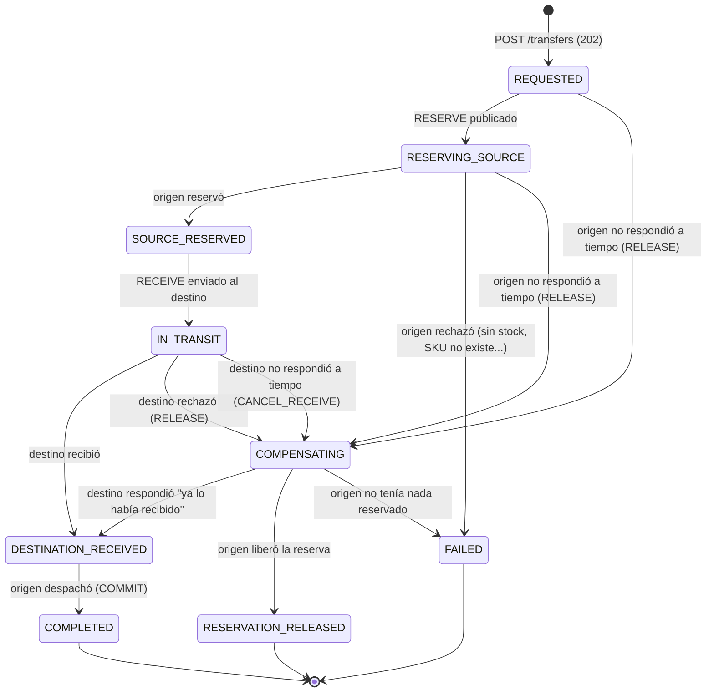

# Fase 6 — Transferencias entre bodegas con una Saga

**Commit 4 · Persona 4** (junto con los reportes de Athena: `docs/fases/REPORTES_ATHENA.md`)
**Objetivo (guía 06):** mover unidades de una bodega a otra **sin una transacción SQL común** entre
sus bases de datos, sin perder ni duplicar unidades aunque algo falle a la mitad.

---

## 1. El problema

```text
WH-001 P-001 = 100        WH-002 P-001 = 20        transferir 30   ->   WH-001 = 70, WH-002 = 50
```

Restar 30 en la base de WH-001 y sumar 30 en la de WH-002 son **dos transacciones en dos bases
distintas**. Si se hace la primera y la segunda falla (WH-002 caída, sin red, producto dado de baja),
desaparecen 30 unidades. Si se reintenta mal, aparecen 30 de más.

**Saga:** dividir la operación en pasos locales (cada uno es una transacción normal en UNA bodega) y,
para cada paso, definir su **compensación** (cómo deshacerlo) por si un paso posterior falla.

---

## 2. Cómo está construida (Saga ORQUESTADA)

```text
  cliente ── POST /transfers ──> CENTRAL (orquestador)                     202 Accepted {"transfer_id":"TR-000001","status":"PROCESSING"}
                                    │  transfers + transfer_history + transfer_commands (OUTBOX)
                                    │
                      central_command_relay ── comandos ──> RabbitMQ central "central.commands"
                                                                 │                 │
                                                       commands.WH-001      commands.WH-002
                                                                 │                 │
                                                  command_worker WH-001    command_worker WH-002
                                                    (1 transacción local:  movimiento + transfer_operations + respuesta en su OUTBOX)
                                                                 │                 │
                                                  relay -> forwarder -> central.events -> cola central.saga
                                                                                              │
                                                                                     central_saga (orquestador)
```

- **La central decide** (qué paso sigue, cuándo compensar). Las bodegas solo ejecutan pasos: no se
  conocen entre ellas.
- **Ni los comandos ni las respuestas se pierden**: los comandos se guardan en un outbox de la
  central (`transfer_commands`) en la misma transacción que el cambio de estado; las respuestas se
  guardan en el outbox de cada bodega en la misma transacción que el movimiento, y viajan por el
  camino sin pérdida de la Fase 7 (relay → forwarder → central).
- **Una cola de comandos por bodega** en el RabbitMQ central: si WH-002 está caída, sus comandos la
  esperan ahí (durables) y las demás bodegas no se enteran.

### Los pasos (comandos) y sus compensaciones

| Comando | Bodega | Movimiento que registra | Compensación |
|---|---|---|---|
| `RESERVE` | origen | `RESERVATION` (disponible → reservado) | `RELEASE` |
| `RECEIVE` | destino | `TRANSFER_IN` (+ disponible). Si no tiene el producto, lo crea con los datos del catálogo central | `CANCEL_RECEIVE` (solo antes de recibir) |
| `COMMIT` | origen | `TRANSFER_OUT` **desde lo reservado** | — (es el último paso) |
| `RELEASE` | origen | `RELEASE` (reservado → disponible) | — |
| `CANCEL_RECEIVE` | destino | ninguno: deja una marca "no recibir esta transferencia" | — |

**¿Por qué reservar primero y despachar al final?** Mientras dura la transferencia, las 30 unidades
están **reservadas** en el origen: no se pueden vender dos veces y, si algo falla, compensar es solo
liberarlas. El despacho (`COMMIT`) ocurre únicamente cuando el destino **confirmó** que las sumó.

```text
                 WH-001 disp.   WH-001 reserv.   WH-002 disp.
inicio               100              0               20
RESERVE               70             30               20      <- IN_TRANSIT
RECEIVE               70             30               50      <- DESTINATION_RECEIVED
COMMIT                70              0               50      <- COMPLETED
```

---

## 3. Diagrama de estados (entregable de la guía)



(Si no se ve el dibujo: GitHub y VS Code con la extensión *Markdown Preview Mermaid* lo muestran. La
versión en texto es la tabla de abajo.) El historial **real** de cada transferencia, con cada cambio
de estado y qué bodega lo causó, está en `GET /transfers/{id}` y en el tablero `/dashboard`.

| Estado | Qué significa | Unidades |
|---|---|---|
| `REQUESTED` | Aceptada; el comando `RESERVE` está en el outbox de la central | sin cambios |
| `RESERVING_SOURCE` | `RESERVE` salió hacia el origen | sin cambios (o reservándose) |
| `SOURCE_RESERVED` | El origen apartó las unidades | reservadas en el origen |
| `IN_TRANSIT` | Se pidió al destino recibirlas | reservadas en el origen |
| `DESTINATION_RECEIVED` | El destino ya las sumó; falta que el origen despache lo reservado | reservadas en origen + sumadas en destino (un instante) |
| `COMPLETED` | Terminada | salieron del origen, entraron al destino |
| `COMPENSATING` | Deshaciendo (`compensation_step` dice si espera al destino o al origen) | reservadas en el origen |
| `RESERVATION_RELEASED` | Compensada: todo quedó como al principio | como al principio |
| `FAILED` | Falló sin haber hecho nada que deshacer | como al principio |

### Explicación de cada compensación

1. **El origen rechaza la reserva** (no hay stock, el SKU no existe, está dado de baja) → `FAILED`.
   No se hizo nada, no hay nada que compensar.
2. **El destino rechaza** (producto dado de baja allá, falla simulada) → `COMPENSATING` →
   la central manda `RELEASE` al origen → `RESERVATION_RELEASED`. Las unidades vuelven a estar
   disponibles en el origen.
3. **El origen no responde a tiempo** (caído, lento) → `COMPENSATING` → `RELEASE` al origen.
   Es seguro aunque nunca haya reservado: `RELEASE` deja una **marca** y un `RESERVE` atrasado de esa
   transferencia se rechaza al llegar. Si había reservado, libera; si no, termina en `FAILED`.
4. **El destino no responde a tiempo** → `COMPENSATING` → la central manda `CANCEL_RECEIVE` al
   destino y **espera su respuesta** antes de liberar la reserva. *No compensa a ciegas*: si el destino
   sí había recibido (y su respuesta venía en camino), liberar la reserva del origen duplicaría
   unidades. El destino responde:
   - "no recibí nada" (y queda la marca: un `RECEIVE` atrasado se rechaza) → `RELEASE` al origen →
     `RESERVATION_RELEASED`;
   - "ya lo había recibido" → la transferencia sigue: `DESTINATION_RECEIVED` → `COMMIT` → `COMPLETED`.
   Si el destino está caído, la transferencia espera en `COMPENSATING` con las unidades **reservadas**
   (ni perdidas ni duplicadas) hasta que vuelva.
5. **El origen no puede despachar** (alguien liberó a mano la reserva) → la transferencia queda con
   `needs_review = true` para revisión manual (el sistema no inventa unidades).

### Idempotencia (la guía: "el worker debe poder recibir TR-001 dos veces sin duplicar")

| Dónde | Llave | Qué evita |
|---|---|---|
| Bodega (`transfer_operations`) | `(transfer_id, paso)` única | Ejecutar dos veces el mismo paso (comando repetido por RabbitMQ, o reenviado) |
| Central (`transfer_history.event_id`) | `event_id` único | Procesar dos veces la misma respuesta |
| Central (estado) | cada respuesta solo vale en ciertos estados | Que una respuesta atrasada retroceda la Saga |
| API (`Idempotency-Key`) | cabecera del POST | Que un doble clic o un reintento del cliente cree dos transferencias |

### Plazos (timeouts)

Cada transferencia tiene `timeout_seconds` por paso (por defecto `SAGA_STEP_TIMEOUT_SECONDS = 60`).
Los comandos `RESERVE` y `RECEIVE` llevan un `deadline`: **una bodega rechaza un comando vencido**
(así un `RECEIVE` que esperó horas en la cola no suma unidades tarde). El `central_command_relay`
revisa los vencimientos cada segundo, con un margen de `SAGA_GRACE_SECONDS = 5`.

---

## 4. Experimentos de la guía (todos con PostgreSQL, RabbitMQ y Nginx reales)

Caso de la guía: P-001 con WH-001 = 100 y WH-002 = 20.

| # | Experimento | Cómo | Resultado |
|---|---|---|---|
| — | **Camino feliz** | `POST /transfers` 30 de WH-001 a WH-002 | 202 `{"transfer_id": "TR-000001", "status": "PROCESSING"}` → `REQUESTED → RESERVING_SOURCE → SOURCE_RESERVED → IN_TRANSIT → DESTINATION_RECEIVED → COMPLETED`. **WH-001 = 70, WH-002 = 50**; la central ve 120. El mismo POST con la misma `Idempotency-Key` devolvió la misma transferencia |
| 1 | **Fallar antes de reservar** | Pedir 1000 | `FAILED`: "Stock insuficiente para reservar. Disponible: 70, requerido: 1000". Nadie cambió |
| 2 | **Fallar después de reservar** | `simulate_failure: DESTINATION_REJECTS` | `… IN_TRANSIT → COMPENSATING → RESERVATION_RELEASED`. WH-001 hizo `RESERVE=DONE, RELEASE=DONE`: quedó en 70 |
| 3 | **Destino caído** | Apagar WH-002 completa; transferir 10 con plazo de 8 s | `IN_TRANSIT` con WH-001 = 60 disponibles + **10 reservadas**. Venció el plazo → `COMPENSATING` y **siguió esperando** (no liberó a ciegas). Al encender WH-002: `RECEIVE=REJECTED` (vencido), `CANCEL_RECEIVE=DONE` → `RESERVATION_RELEASED`; WH-001 = 70, WH-002 = 50 |
| 4 | **Mensaje duplicado** | Publicar 3 veces el `RESERVE` de TR-000001 y 3 veces su respuesta | WH-001 no reservó otra vez (`transfer_operations` sin cambios); TR-000001 siguió `COMPLETED` |
| 5 | **Timeout** | WH-002 encendida pero su `command_worker` detenido; plazo de 6 s | `COMPENSATING` al vencer el plazo (6 s + margen). Al volver el worker: `RECEIVE` vencido **rechazado** (no sumó tarde), `CANCEL_RECEIVE=DONE` → `RESERVATION_RELEASED` |
| 6 | **Worker reiniciado** | Apagar el orquestador (`central_saga`) y pedir 20 | WH-001 igual reservó (el comando ya había salido); su respuesta esperó en `central.saga`. Al volver: `IN_TRANSIT`. Luego se apagó el relay de comandos: el `RECEIVE` esperó en la base central. Al volver: `COMPLETED` (WH-001 = 50, WH-002 = 70) |
| ✔ | **Conservación** | Sumar al final | WH-001 + WH-002 = **120** unidades físicas, igual que al principio, y la central también ve 120 |

**Repetirlo con Docker** (con `.\manage.ps1 start all`):

```powershell
python scripts/demo_fase6.py
```

Hace todos los experimentos con `docker stop/start` y verifica cada número (≈ 1-2 minutos). Crea su
propio producto `DEMO-T-xxxxxx`.

---

## 5. Cómo usarlo

| Qué | Dónde |
|---|---|
| Tablero de la central (bodegas, inventario global, **formulario de transferencias**, historial paso a paso, reportes) | http://localhost:8090/dashboard |
| API (Swagger) | http://localhost:8090/docs → *Transfers (Saga, Fase 6)* |
| Colección de peticiones | `tests/http/central-api.http` (peticiones 20 a 25) |
| Lo que hizo cada bodega | `GET http://localhost:8001/transfer-operations?transfer_id=TR-000001` |

```http
POST http://localhost:8090/transfers
Content-Type: application/json
Idempotency-Key: pedido-123

{"sku": "P-001", "source_warehouse_id": "WH-001", "destination_warehouse_id": "WH-002", "quantity": 30}
```

Opcionales: `timeout_seconds` (5-3600) y `simulate_failure` (`SOURCE_REJECTS` o `DESTINATION_REJECTS`,
solo si `SAGA_ALLOW_SIMULATION=true`).

**Transferencias manuales bloqueadas:** `POST /inventory/movements` con `TRANSFER_OUT` o `TRANSFER_IN`
responde **409**: una salida sin su entrada en la otra bodega descuadraría la empresa. En la página de
cada bodega esas opciones aparecen deshabilitadas.

### Contenedores nuevos

| Dónde | Contenedor | Qué hace |
|---|---|---|
| Cada bodega | `command_worker_WH-00X` | Escucha `commands.WH-00X` en el RabbitMQ central y ejecuta cada paso |
| Central | `central_saga` | Recibe las respuestas (`central.saga`) y avanza la máquina de estados |
| Central | `central_command_relay` | Publica los comandos del outbox de la central y revisa los vencimientos |

---

## 6. ¿Por qué orquestación y no coreografía?

| | Orquestación (elegida) | Coreografía |
|---|---|---|
| Quién decide | La central, en un solo lugar (`central/saga.py`) | Cada bodega reacciona a eventos de las otras |
| Ver en qué va una transferencia | `GET /transfers/{id}` | Hay que juntar eventos de varias bodegas |
| Acoplamiento | Las bodegas no se conocen entre sí | Cada bodega debe conocer los eventos de las demás |
| Timeouts y compensaciones | Centralizados y probados como funciones | Repartidos (difícil de probar) |
| Punto único de falla | La central — pero si se cae, nada se pierde: todo queda en colas y outbox y sigue al volver (experimento 6) | No hay |

Ver `docs/adr/ADR-008-saga-orquestada.md`.

---

## 7. Pruebas

| Archivo | Qué comprueba |
|---|---|
| `tests/unit/test_transfer_commands.py` (15) | Cada paso en la bodega: reserva y despacho, duplicados, sin stock, vencidos, `RELEASE` que deja marca, no liberar lo despachado, el destino crea el producto, `CANCEL_RECEIVE` antes/después de recibir, falla simulada, 409 para transferencias manuales, comandos de otra bodega o corruptos |
| `tests/unit/test_inventory_rules.py` (+2) | `TRANSFER_OUT` desde la reserva |
| `tests/central/test_saga.py` (13) | Camino feliz completo, `Idempotency-Key`, cada falla y compensación, respuestas repetidas o de la bodega equivocada, timeouts del origen y del destino, destino lento que sí recibió, RabbitMQ caído (la transferencia espera en `REQUESTED`) |
| `tests/integration/test_transfer_integration.py` (1) | Con Docker: WH-001 → WH-002 de punta a punta (WH-002 crea el producto) |

```powershell
pytest tests/unit tests/central     # 142 pruebas, sin Docker
```

---

## 8. Respuestas para la sustentación

**¿Por qué no una transacción distribuida (2PC)?** Bloquea las dos bases mientras se decide y, si el
coordinador se cae a mitad, ambas quedan bloqueadas. Además exige que todas las bodegas estén arriba
a la vez, justo lo contrario de la autonomía de la Fase 4.

**¿Qué es una compensación?** Una acción de negocio que deshace el efecto de un paso ya confirmado
(aquí, `RELEASE` deshace `RESERVE`). No es un ROLLBACK: el paso sí ocurrió y queda en el historial.

**¿Qué pasa si la central se cae a mitad?** Nada se pierde: los comandos pendientes están en su
outbox, las respuestas esperan en `central.saga` y el estado de cada transferencia está en su base.
Al volver, sigue donde iba (experimento 6).

**¿Y si un mensaje llega dos veces?** La bodega no repite el paso (`transfer_id + paso` es único) y la
central no procesa dos veces la misma respuesta (`event_id`).

**¿Por qué no se libera la reserva apenas vence el plazo del destino?** Porque "no respondió" no
significa "no recibió": su respuesta podía venir en camino. Liberar sin preguntar podría dejar las
unidades en las dos bodegas. Se le pide `CANCEL_RECEIVE` y se espera la respuesta.

**¿Consistencia?** Eventual: durante unos segundos las unidades están "en tránsito" (reservadas). Al
final, siempre, origen + destino = lo mismo que al principio.

---

## 9. Archivos de este commit (parte Saga)

| Archivo | Qué es |
|---|---|
| `src/common/platform_common/commands.py` | **Nuevo.** Contrato de comandos y respuestas |
| `src/common/platform_common/central_topology.py` | Exchange `central.commands`, colas `commands.<bodega>` y `central.saga` |
| `src/central/central/saga.py` | **Nuevo.** Máquina de estados, compensaciones y plazos |
| `src/central/central/routers/transfers.py` | **Nuevo.** `POST /transfers`, `GET /transfers`, `GET /transfers/{id}` |
| `src/central/central/workers/saga.py`, `command_relay.py` | **Nuevos.** Orquestador y relay de comandos |
| `src/central/central/models.py`, `db/central_schema.sql`, `db/migrations/central_002_saga_y_athena.sql` | Tablas `transfers`, `transfer_history`, `transfer_commands` |
| `src/backend/app/app/modules/transfers/` | **Nuevo.** Pasos de la Saga en la bodega y `GET /transfer-operations` |
| `src/backend/app/app/workers/command_worker.py` | **Nuevo.** Consume `commands.<bodega>` |
| `src/backend/app/app/modules/inventory/*` | `apply_movement` (sin commit, lo comparten API y Saga), `TRANSFER_OUT` desde la reserva, 409 a transferencias manuales |
| `db/schema.sql`, `db/migrations/002_fase6_transferencias.sql` | Tabla `transfer_operations` |
| `src/central/central/static/dashboard.html` | El tablero de la Fase 7 ahora tiene el formulario de transferencias, su historial paso a paso y los reportes de Athena |
| `src/frontend/app/*` | `TRANSFER_*` deshabilitados en la página de la bodega |
| `docker/composes/*.yml`, `docker/components/central/.env` | `command_worker`, `central_saga`, `central_command_relay` |
| `scripts/demo_fase6.py` | **Nuevo.** Los experimentos contra Docker |
| `tests/unit/test_transfer_commands.py`, `tests/central/test_saga.py`, `tests/integration/test_transfer_integration.py` | Pruebas |
| `docs/adr/ADR-008-saga-orquestada.md` | Decisión de arquitectura |
